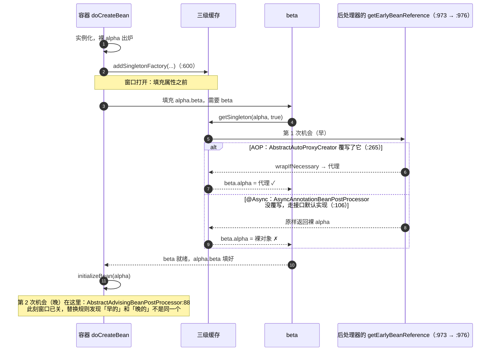

# 第 30 章 三级缓存与循环依赖

> 🌿(ch00–ch29) 🕳️

> 本章代码：`step-30-circular-dependencies`。测试 **436** 个（新增 4），行覆盖 86.5%（3047/3521）、
> 分支覆盖 75.9%（1173/1546）。新增主代码只有 42 行的 `BeanCurrentlyInCreationException` 与 54 行的
> `SmartInstantiationAwareBeanPostProcessor`，其余全是往三个已有类里加东西：
> `DefaultSingletonBeanRegistry`（433 行）、`DefaultListableBeanFactory`（1170 行）、
> `AbstractAutoProxyCreator`（204 行）。

第 29 章场景五留下了两个问题：循环依赖在我们的容器里**直接栈溢出**；场景六则说明，就算环解开了，
注入方拿到的也可能是**裸对象**。

这一章把这两件事一起解决，而且要证明一件事：**第二级缓存不够，第三级不是「多一层保险」，是必需的。**
证明方式不是断言，是实验——同一份 XML、同一个容器，只把「提前暴露时交什么」换掉，看结果怎么变。

## 1. 痛点：三种错误答案

被问到「Spring 怎么解决循环依赖」时，最常听到的三种回答，一种比一种接近，但都不够：

**错误答案一：「用三级缓存。」** —— 这是把答案背下来了，没解释。三级缓存各自解决什么问题？
把中间那一级删掉会怎样？说不出来，就说明没懂。

**错误答案二：「三级缓存是为了性能。」** —— 反了。三级缓存是**为了正确性**，代价恰恰是性能：
多两个 Map、多一次 `ObjectFactory` 间接调用、多一个「创建中」集合的读写。真实 Spring 里
`getSingleton` 的快路径之所以要写那么多遍判空，就是被这套机制逼出来的。

**错误答案三：「延迟注入 / `@Lazy` 就能解环。」** —— 那只解决了「构造器注入的环」里的一小类
（把强依赖改成「用时再取」）。setter 注入的环本来就能解，问题是**解出来的对象对不对**；
`@Lazy` 一个字节都不帮忙。

正确的答案是三个问题：

1. **什么时候允许别人拿到一个还没初始化完的对象？** —— 实例化之后、填充属性之前（唯一窗口）。
2. **拿到的是哪个对象？** —— 裸对象的话，代理就丢了；必须让「要不要包代理」这个决定能推迟。
3. **一个环解开之后，池子里的对象和注入方手里的对象，是同一个吗？** —— 如果不是，就埋了第 29 章
   场景六那颗雷。

## 2. 先写会红的测试：三个实验，一份 XML

实验材料只有一份 XML：

```xml
<bean id="alpha" class="org.springframework.samples.ch30.Alpha">
    <property name="beta" ref="beta"/>
</bean>
<bean id="beta" class="org.springframework.samples.ch30.Beta">
    <property name="alpha" ref="alpha"/>
</bean>
```

两个 Bean 都写成 **setter 注入**。这不是随便选的：构造器注入的环**没有解**——两个对象都得先有对方
才能存在，那是逻辑矛盾，任何缓存都救不了。setter 注入的环才有解：先造空壳，等对方好了再填进去。

三个实验共用同一个容器实现，差别只在两个「能力开关」上（测试里用两个子类表达，不改产品代码）：

| 实验 | 子类做了什么 | 等价于 |
| --- | --- | --- |
| 只有检测 | `addSingletonFactory` 空实现 | 「我知道有环，但我不提前暴露」 |
| 两级缓存 | `getEarlyBeanReference` 直接返回裸对象 | 「提前暴露，但交出的是算好的对象」 |
| 三级缓存 | 什么都不改 | 「提前暴露，交出的对象现算」 |

### 红一：只有检测，普通环也炸

```
org.springframework.beans.factory.BeanCurrentlyInCreationException:
  Requested bean is currently in creation: Is there an unresolvable circular reference?
```

五个测试**全红**（包括普通环）。这是本章第一个真实的教训：**「检测」和「解决」是两件事**。
第 29 章场景五是栈溢出（1024 帧 `doCreateBean`），现在是异常——错误信息从「栈的形状」变成了
「图的形状」，好查多了，但**这个环明明能解**。

### 红二：两级缓存，代理丢了

加上「提前暴露」之后，普通环的测试绿了。代理场景的断言红了：

```
Expecting value to be true but was false
  ProxyCircularDependencyTests.threeLevelCacheKeepsTheProxy:89
```

断言是 `AopUtils.isAopProxy(beta.getAlpha())`。原因很清楚：提前暴露时我们交出去的是**裸对象**，
而那时 `postProcessAfterInitialization` 还没跑，「要不要包代理」这个问题还没有答案。

### 红三：有了第三级，但代理创建器不知道

第三级缓存换成「延迟工厂」之后，仍然红。因为工厂里问的是
`SmartInstantiationAwareBeanPostProcessor#getEarlyBeanReference`，而我们的自动代理创建器
**还没实现这个接口**——默认实现返回原对象，于是工厂绕了一圈还是交出裸对象。

补上 `getEarlyBeanReference` 之后才绿。这条红说明第三级缓存的关键不在「延迟」，而在
**「延迟到谁来回话」**。

### 红四：两个 `toString` 一样的对象

最后一个红最值得看。两级缓存那次实验里，我加了一条「注入方与池子里是同一个对象」的断言：

```
Expecting actual:
  org.springframework.samples.ch30.Alpha@15a902e7
and:
  org.springframework.samples.ch30.Alpha@15a902e7
to refer to the same object
```

打印出来两个**一模一样**的 `Alpha@15a902e7`（`Object.toString` 用的是 identity hash），
却不是同一个对象。查下去发现：池子里放的是 after 阶段正常包出来的代理，注入方手里是提前暴露的裸对象；
代理把 `toString()` 转发给裸对象，于是两条字符串相同。

**这正是第 29 章场景六的真实版本**，也是真实 Spring 那条著名警告的现场：

```
Bean with name 'alpha' has been injected into other beans [beta] in its raw version as part of a
circular reference, but has eventually been wrapped. ...
```

真实 Spring 在这种情况下**直接抛异常**（`allowRawInjectionDespiteWrapping` 默认为 `false`）。
我们没抛，于是它成了一个可运行的反证测试。

## 3. 实现：三个 Map，一个窗口，一条替换规则

### 3.1 三个 Map 各管什么

```java
private final Map<String, Object> singletonObjects = new ConcurrentHashMap<>(256);          // 一级：成品
private final Map<String, Object> earlySingletonObjects = new ConcurrentHashMap<>(16);      // 二级：算好的提前引用
private final Map<String, ObjectFactory<?>> singletonFactories = new HashMap<>(16);         // 三级：算得出的办法
private final Set<String> singletonsCurrentlyInCreation = ConcurrentHashMap.newKeySet(16);  // 谁在创建中
```

一句话区分二、三级：**二级存对象，三级存「怎么得到对象」**。

- 二级缓存的语义是「**现在**就把提前引用算出来给你」。可 `alpha` 刚实例化完的那一刻，
  「该不该包代理」还没有答案（属性还没填、后处理器还没跑），只能交出裸对象；
- 三级缓存存的是一个工厂，**等到真的有人来要**才求值。那一刻我们已经在
  `getEarlyBeanReference` 里问过了所有 `SmartInstantiationAwareBeanPostProcessor`，
  于是可以交出代理。

为什么还需要二级？因为**工厂每次调用都会重新执行一遍**。环里可能有两三个 Bean 都要 `alpha`，
不把第一次的结果存下来，就会造出好几个代理——"同一个 Bean" 就不成立了。

### 3.2 唯一能插入的窗口

```java
private Object doCreateBean(String beanName, BeanDefinition beanDefinition) {
    Object bean = (... instantiate ...);
    // 实例化之后、填充属性之前——这是唯一能插入「提前暴露」的窗口。
    // 早了没有对象可暴露，晚了属性已经填完、环已经炸过。
    if (beanDefinition.isSingleton()) {
        addSingletonFactory(beanName, () -> getEarlyBeanReference(beanName, bean, beanDefinition));
    }
    populateBean(beanName, beanDefinition, bean);
    ...
}
```

「唯一窗口」的论证很硬：

- 早于实例化 → 没有对象可交；
- 晚于 `populateBean` → 属性里的环已经在填充期间炸过了，来不及了；
- 而 `initializeBean`（后处理器的 after 阶段）必须排在填充之后，所以「包代理」这个动作
  **天然晚于**「提前暴露」。

这三条合起来就推出了第三级缓存的必要性：**要交出去的时刻（填充期间），代理还不存在；
而代理只可能在之后才被造出来。** 于是唯一的出路是「交出一个能延后求值的工厂」。

### 3.3 一条替换规则

提前引用交出去之后，`initializeBean` 会正常跑完并返回一个对象。池子里该放哪个？

```java
if (beanDefinition.isSingleton()) {
    Object earlySingletonReference = getSingleton(beanName, false);
    if (earlySingletonReference != null && initializedBean == bean) {
        initializedBean = earlySingletonReference;
    }
}
```

两个条件都要成立才替换：

- `earlySingletonReference != null` —— 说明**确实有人要过**它（否则二级缓存里没有，说明这个 Bean
  根本没参与环，池子里放正常结果就行）；
- `initializedBean == bean` —— 说明 after 阶段**没有**换过对象（换过就说明正常路径已经包出了代理，
  而提前引用那一份是另一个对象，此时不该拿旧的覆盖新的）。

第二条正是红四的成因：两级缓存实验里 `initializedBean != bean`（after 阶段包了代理），于是不替换，
池子里放代理、注入方拿裸对象 —— 两个对象。

### 3.4 检测：把栈溢出换成一句人话

```java
protected void beforeSingletonCreation(String beanName) {
    if (!this.singletonsCurrentlyInCreation.add(beanName)) {
        throw new BeanCurrentlyInCreationException(beanName);
    }
}

protected void afterSingletonCreation(String beanName) {
    this.singletonsCurrentlyInCreation.remove(beanName);
}
```

两个方法必须**成对**调用，且 `afterSingletonCreation` 放在 `finally` 里：创建失败时若不摘掉标记，
这个 Bean 会永远「在创建中」，之后每一次合法创建都会被误判成环。

真正解不开的环（例如构造器注入的环）就会在这里抛出。能解的环根本走不到这里 —— 它们在
`getSingleton(beanName)` 的提前引用查找里就被满足了。

### 3.5 谁来回话：`SmartInstantiationAwareBeanPostProcessor`

```java
public interface SmartInstantiationAwareBeanPostProcessor extends BeanPostProcessor {

    default Object getEarlyBeanReference(Object bean, String beanName) {
        return bean;
    }
}
```

默认答案是「没什么可加工的」。自动代理创建器覆写它：

```java
@Override
public Object getEarlyBeanReference(Object bean, String beanName) {
    Object cacheKey = getCacheKey(bean.getClass(), beanName);
    this.earlyProxyReferences.put(cacheKey, bean);   // 记的是「原始对象」，只为判断包过没包过
    return wrapIfNecessary(bean, beanName);          // 现在就包成代理
}

@Override
public Object postProcessAfterInitialization(Object bean, String beanName) {
    if (this.earlyProxyReferences.remove(getCacheKey(bean.getClass(), beanName)) != bean) {
        return wrapIfNecessary(bean, beanName);
    }
    return bean;   // 已经包过了：这次返回裸对象，「池子里放哪个」交给 doCreateBean 决定
}
```

注意 `postProcessAfterInitialization` 在「已经包过」时返回的是**裸对象**——这看起来像 bug，
其实是分工：它只负责「别包两次」，「池子里放哪个」由 §3.3 那条替换规则负责。

## 4. 关键源码逐行

### 4.1 `getSingleton(String)` 为什么是「带参数版本」的转发

```java
@Override
public Object getSingleton(String beanName) {
    return getSingleton(beanName, true);
}
```

`true` 是本章的枢纽。它意味着**任何一次「按名字取单例」都允许拿到提前引用**，而不只是「解析依赖」时。
少了这个 `true`，环里的第二次 `getBean` 会一路走到 `getSingleton(name, factory)`，被「创建中」检测
拦下——红一就是这样炸的。

那为什么还要有 `allowEarlyReference=false` 的调用？给「我只是想看一眼，别给我造东西」的查询用：
`getBeanNamesForType`、`isTypeMatch` 这类探询如果拿提前引用，一次类型扫描就会把半成品对象提前造出来。

### 4.2 三级查找的完整顺序

```java
Object singletonObject = this.singletonObjects.get(beanName);                 // ① 成品
if (singletonObject == null && isSingletonCurrentlyInCreation(beanName)) {
    singletonObject = this.earlySingletonObjects.get(beanName);               // ② 算好的提前引用
    if (singletonObject == null && allowEarlyReference) {
        this.singletonLock.lock();
        try {
            singletonObject = this.singletonObjects.get(beanName);            // ③ 进锁后重读
            if (singletonObject == null) {
                singletonObject = this.earlySingletonObjects.get(beanName);
                if (singletonObject == null) {
                    ObjectFactory<?> singletonFactory = this.singletonFactories.get(beanName);
                    if (singletonFactory != null) {
                        singletonObject = singletonFactory.getObject();       // ④ 第一次求值
                        this.earlySingletonObjects.put(beanName, singletonObject);
                        this.singletonFactories.remove(beanName);
                    }
                }
            }
        }
        finally { this.singletonLock.unlock(); }
    }
}
```

三个细节值得记：

1. **`isSingletonCurrentlyInCreation` 是前置条件**，不是优化。不在创建中却去查提前引用，等于允许
   「随便什么时候都能拿到半成品」，那就没有边界了。
2. **进锁后要重读一遍**，因为抢锁期间别的线程可能已经把它造完（①/②都可能变了）。
3. **求值后立刻搬进二级缓存并删掉工厂**：工厂不能再被执行第二次（否则会造出第二个代理）。

### 4.3 三个 Map 的清理时机

`addSingleton` 里必须把二、三级都清掉：

```java
this.singletonObjects.putIfAbsent(beanName, singletonObject);
this.registeredSingletons.add(beanName);
this.earlySingletonObjects.remove(beanName);
this.singletonFactories.remove(beanName);
```

不清的后果很具体：下一次解析依赖时，`getSingleton(beanName, true)` 会先看二级缓存，拿到那个
**早就被替换掉的**早期对象——又是第 29 章场景六。

## 5. 🔍 真实 Spring 里它在哪

### 5.1 一张行号表

| 我们的实现 | 真实 Spring（6.2.x） | 行数 |
| --- | --- | --- |
| `singletonObjects` | `DefaultSingletonBeanRegistry.java:85` | `ConcurrentHashMap<>(256)` |
| `singletonFactories` | `:88` | 6.2 起是 `ConcurrentHashMap`（我们用 `HashMap` + 锁） |
| `earlySingletonObjects` | `:94` | `ConcurrentHashMap<>(16)` |
| `registeredSingletons` | `:97` | `Collections.synchronizedSet(new LinkedHashSet<>(256))` |
| `singletonsCurrentlyInCreation` | `:100` | `ConcurrentHashMap.newKeySet(16)` |
| `addSingleton` | `:159` | 清二、三级 |
| `addSingletonFactory` | `:183` | 存工厂 |
| `getSingleton(String)` | `:197` | `return getSingleton(beanName, true);` |
| `getSingleton(String, boolean)` | `:210` | 三级查找 |
| `beforeSingletonCreation` / `afterSingletonCreation` | `:542` / `:554` | 成对调用 |
| `BeanCurrentlyInCreationException` | `BeanCurrentlyInCreationException.java`（48 行） | 消息句式与我们一致 |
| `addSingletonFactory(...)` 调用点 | `AbstractAutowireCapableBeanFactory.java:600` | 实例化后、`populateBean` 前 |
| 提前引用替换 | `AbstractAutowireCapableBeanFactory.java:618-647` | 我们只保留核心两个条件 |
| 「裸版注入」异常 | `AbstractAutowireCapableBeanFactory.java:630-641` | 消息在 `:634` |
| `getEarlyBeanReference`（容器侧） | `AbstractAutowireCapableBeanFactory.java:973`（循环 `:977`） | 遍历 `SmartInstantiationAwareBeanPostProcessor` |
| `SmartInstantiationAwareBeanPostProcessor#getEarlyBeanReference` | `SmartInstantiationAwareBeanPostProcessor.java:106` | 默认返回原对象 |
| `getEarlyBeanReference`（代理侧） | `AbstractAutoProxyCreator.java:265` | 先记原始对象，再包 |
| `postProcessAfterInitialization` | `AbstractAutoProxyCreator.java:315` | 包过就返回裸对象 |
| `getCacheKey` | `AbstractAutoProxyCreator.java:337` | `FactoryBean` 会加 `&` 前缀 |
| `wrapIfNecessary` | `AbstractAutoProxyCreator.java:354` | 真正的包装 |

### 5.2 那个 `tryLock`：我们做错的地方

真实 `getSingleton(beanName, allowEarlyReference)` 抢锁用的是 `tryLock()`，抢不到直接返回 `null`：

```java
if (!this.singletonLock.tryLock()) {
    // Avoid early singleton inference outside of original creation thread.
    return null;
}
```

注释把这件事故意说破了：**提前引用只应该在「正在创建这个 Bean 的那个线程」里被推导出来**。
换成 `lock()` 会怎样？另一个线程来要提前引用时会阻塞在锁上，一直等到创建线程把整条创建链
走完 —— 这不是死锁，是**串行**（第 31 章 `31-concurrency.md:104` 有正式更正：全类只有一把
可重入锁，等待图成不了环），代价是等待时间被拉长到整条链。

我们用 `lock()`。这是本章如实记录的缺陷：单线程测试永远发现不了，只有在并发创建 + 循环依赖同时
出现时才会锁死。

### 5.3 「二级缓存够不够」的争论，以及为什么必须有第三级

网上有大量「二级缓存也能跑」的说法。要看清它错在哪，得把两件事分开：

- **能不能解开环**：二级缓存单独就能解。红二证明了这个（普通环的测试是绿的）。
- **解出来的对不对**：二级缓存解出来的对象，注入方拿到的是裸对象，而池子里放的是代理（红四）。

于是「二级够不够」的答案取决于你准不准备接受「同一个 Bean 有两个身份」。真实 Spring 的选择是
**不接受**，并且更进一步：如果检测到这种不一致，直接抛
`BeanCurrentlyInCreationException`（`:630`），而不是安静地留一个坑。

那为什么不用「延迟代理」——即二级缓存也存工厂？那就已经是三级缓存了。命名的区别不重要，
机制的区别只有一条：**「交出去的时机」与「能不能加工」是不是解耦的**。

这条判断还有第三种结局，本节没覆盖、第 [6 节](#6-能力边界async-为什么让三级缓存失效) 专门讲：
**三级缓存在，但代理晚了一步**——`@Async` 的代理在初始化之后才产生，提前引用只能是裸对象。
环照样解开，注入方拿到的却是「同步版」。

### 5.4 与 `@Lazy` 的关系

`@Lazy` 注入的是**代理**（一个 `ObjectFactory` 的前身），所以它能让「构造器注入的环」变成可解：
先把一个还没初始化的代理塞进去，等真要用时再从容器取。

但它与三级缓存解决的不是同一个问题：

| | 三级缓存 | `@Lazy` |
| --- | --- | --- |
| 解决 | setter/字段注入的环，且**保证代理不丢** | 构造器注入的环（提前给占位代理） |
| 代价 | 两个 Map、一次工厂调用、`isCurrentlyInCreation` 读写 | 多一层代理、类型判断变复杂、`final` 类不可用 |
| 边界 | 只对单例有效 | 对 prototype 也有效 |

## 6. 能力边界：`@Async` 为什么让三级缓存失效

前面五节都在讲「三级缓存怎么把代理保住」。这一节讲反面：**有一种代理，三级缓存救不了它。**
它也是真实项目里最容易踩的一脚——一个 `@Async` 方法撞上循环依赖，启动直接失败，
报出来的却是一句「in its raw version ... but has eventually been wrapped」。
`spring-framework` 仓库里就挂着这样一份报告：issue
[#35554](https://github.com/spring-projects/spring-framework/issues/35554)
《Problem in `@Async` annotation and circular dependencies》，2025-09 提交，至今仍是 open 状态。

### 6.1 时序：两次「包装」机会，一次在窗口里，一次在窗口外

容器给后处理器留了**两次**「把裸对象包成代理」的机会。三级缓存只对第一次有效：



时序里有两个时刻，名字都很长，但记住它们的**先后**就够了：
`getEarlyBeanReference`（`:973`，早）与 `postProcessAfterInitialization`（`:88`，晚）。
三级缓存能捎出去的，只有「早」那一刻求出来的对象。

### 6.2 一句话根因

> **`@Async` 的代理是在初始化之后才创建的（`postProcessAfterInitialization`），
> 而三级缓存能捎带出去的只有初始化之前求出的提前引用。早的那次它没覆写、给不出代理；
> 晚的那次没人再回来取。于是环里的注入方永远拿不到异步代理。**

对照组一句话：AOP 代理不炸，是因为 `AbstractAutoProxyCreator` **两个**入口都实现了——提前引用
那一次就把代理造出来（`:265`），after 阶段再从 `earlyProxyReferences` 里取回同一个对象。
`AsyncAnnotationBeanPostProcessor` 继承自 `AbstractAdvisingBeanPostProcessor`（`:37` 声明了
`SmartInstantiationAwareBeanPostProcessor`），但整个类**没有**覆写 `getEarlyBeanReference`，
于是走接口默认实现 `SmartInstantiationAwareBeanPostProcessor:106`——`return bean;`，原样奉还。

### 6.3 与第 27、28 章对照：同样是代理，命运不同

| | AOP 代理（`AbstractAutoProxyCreator`） | `@Async` 代理（`AsyncAnnotationBeanPostProcessor`） |
| --- | --- | --- |
| 代理在哪个阶段产生 | `getEarlyBeanReference`（`:265`）与 `postProcessAfterInitialization`（`:315`）**两个**入口，先到先包、包过记账 | 只有 `postProcessAfterInitialization`（`AbstractAdvisingBeanPostProcessor:88`）**一个**入口 |
| 提前引用交出什么 | 代理（`wrapIfNecessary`），并记进 `earlyProxyReferences` | 裸对象（接口默认实现 `:106`） |
| 能不能进三级缓存 | 能 | 不能 |
| 环里有依赖方时的结果 | 注入方拿到代理，`isSameAs` 成立（第 30 章红二的绿灯） | 注入方拿到裸对象；真实 Spring 在 `:619`/`:622` 判定后于 `:631` 抛 `BeanCurrentlyInCreationException` |
| 没有环时 | 无差别 | 无差别（异步正常工作） |

两条交叉引用值得顺着读：

- **第 27 章**回答「字段填在谁身上」——提前引用交出去的是**代理**，目标源在代理内部，
  这是本章三级缓存能成立的物理前提。`@Async` 恰好违反了这条前提。
- **第 28 章**回答「`this` 不是代理」。`@Async` 上是它的变体：**注入进来的那个也不是代理**。
  两种情况下业务代码写的 `service.doAsync()` 都在同步执行，区别只是你在哪一层被骗。

### 6.4 最小复现：「只在 after 阶段包装」的后处理器

不用装 Spring，也不用改本章的容器：`@Async` 的行为可以用一个**只实现 `BeanPostProcessor`、
只在 after 阶段包装**的后处理器等价模拟出来。它与 `AdvisorAutoProxyCreator` 的差别只有一行——
谁被加进 `addBeanPostProcessor`：

```java
// @Async 的等价物：只在 after 阶段包装，不实现 SmartInstantiationAwareBeanPostProcessor
static class AsyncLikePostProcessor implements BeanPostProcessor {

	private final CountingInterceptor interceptor;

	AsyncLikePostProcessor(CountingInterceptor interceptor) {
		this.interceptor = interceptor;
	}

	@Override
	public Object postProcessAfterInitialization(Object bean, String beanName) {
		if (!"alpha".equals(beanName)) {
			return bean;
		}
		ProxyFactory proxyFactory = new ProxyFactory(bean);
		proxyFactory.addAdvice(this.interceptor);
		return proxyFactory.getProxy();
	}

}
```

跑两组，唯一差别是容器里挂哪个后处理器：

```java
CountingBeanFactory factory = new CountingBeanFactory();        // 数 getEarlyBeanReference 的调用
new XmlBeanDefinitionReader(factory).loadBeanDefinitions(new ClassPathResource("ch30/circular.xml"));
factory.addBeanPostProcessor(new AsyncLikePostProcessor(interceptor));   // 对照组换成 AdvisorAutoProxyCreator
factory.preInstantiateSingletons();
```

真实输出（探针在 `/tmp/probe60`，跑在 `step-30-circular-dependencies/target/classes` 上）：

```text
── 对照组：AdvisorAutoProxyCreator（AOP 代理，走 getEarlyBeanReference）
   getEarlyBeanReference(alpha) 调用次数 = 1，交出去的提前引用是代理 = true
   池子里的 alpha 是代理 = true
   beta.getAlpha() 是代理 = true
   两者是同一个对象 = true
   通过注入引用调用 hello() = alpha，增强被调用次数 = 1

── 实验组：AsyncLikePostProcessor（@Async 那种 only-after 包装）
   getEarlyBeanReference(alpha) 调用次数 = 1，交出去的提前引用是代理 = false
   池子里的 alpha 是代理 = true
   beta.getAlpha() 是代理 = false
   两者是同一个对象 = false
   通过注入引用调用 hello() = alpha，增强被调用次数 = 0
```

四行数字就是全部故事：同一份 XML、同一个环，换掉一个后处理器，
**提前引用从「代理」变成「裸对象」**，注入方手里的对象与池子里的对象从「同一个」变成「两个」，
增强被调用次数从 1 变成 0——`beta` 背后那条路彻底绕过异步。

真实 Spring 不会让这种不一致静默存在。它在 `:617` 拿到提前引用、在 `:619` 比较
`exposedObject == bean`，一旦发现「包过一层」就继续往下走，最后在 `:631` 抛异常。
本章没实现 `hasDependentBean` 与 `allowRawInjectionDespiteWrapping`（见「这一章砍掉了什么」），
所以只能把那段判定抄成二十行，验证消息长什么样：

```text
── 真实 Spring 的判定（:617-637）在这组事实下的结果
   抛出：IllegalStateException
   消息含 "raw version" = true，含 "wrapped" = true
```

消息全文（`AbstractAutowireCapableBeanFactory:631-637`）：
「Bean with name 'alpha' has been injected into other beans [beta] in its raw version as part of a
circular reference, but has eventually been wrapped. This means that said other beans do not use the
final version of the bean.」——这正是本章红四里引用过、但我们的容器没有能力抛出的那句话。

### 6.5 三种解法，以及什么时候不该用

| 解法 | 怎么解开 | 代价 | 什么时候不该用 |
| --- | --- | --- | --- |
| `@Lazy` 注入 | 注入一个占位代理，真要用时才回容器取，环被时间错开 | 多一层代理；`final` 类、`final` 方法失效；类型判断变复杂 | 循环两端的调用都在构造期就要用到对方；或类被 `final` 修饰 |
| `ObjectProvider<T>` / `ObjectFactory<T>` | 同上，但把「延迟」写在代码里，意图更明确 | 每次取都是一次容器查询，写法变啰嗦；`getObject()` 的时机由你负责 | 只是偶尔用一次延迟、却要付全链路的可读性代价；或者团队里有人会把它当万能药 |
| 重构，拆掉环 | 抽出第三方法（C），A、B 都依赖 C；异步动作用事件/消息解耦 | 要改设计，短期成本最高 | 拆出来的是一个贫血的、只为消环而存在的类——那只是把环藏起来了 |
| （真实 Spring 的另一条路）`allowRawInjectionDespiteWrapping = true` | 允许裸版注入，容器不再抛异常 | **把错误静默化**：注入方拿到的是同步版，异步过期、事务失效，且没有任何日志 | 除了「先让启动过」的临时救火，正常代码里不该出现 |

最后一行是重点：前面三种是**解题**，最后一种是**把题目藏起来**。
本章红四的容器行为恰好等于这一行——它不抛异常，于是不一致安静地留在那儿。

### 6.6 回到 5.3：三种「解出来对不对」

[5.3 节](#53-二级缓存够不够的争论以及为什么必须有第三级)把「能不能解环」与「解出来对不对」分开。
`@Async` 给出了第三种组合，正好补全这张表：

| 配置 | 能不能解环 | 解出来对不对 |
| --- | --- | --- |
| 只有一/二级缓存 | 能（普通环） | **不对**：注入方是裸对象（红二） |
| 三级缓存 + AOP 代理 | 能 | **对**：注入方与池子里是同一个代理（红二的反面） |
| 三级缓存 + `@Async` 代理 | 能 | **不对**：注入方是裸的「同步版」；真实 Spring 直接抛异常 |

所以三级缓存不是「代理保险箱」，它只是把**一个**特定时机（初始化之前）能算出来的代理保住。
后处理器在晚于那个时机才产生代理，缓存再好也只能看着。

## 7. 思考题

先自己写，再看 [`../appendix/B-answers.md#第-30-章`](../appendix/B-answers.md#第-30-章)。

1. 为什么「提前暴露」的窗口只能在「实例化之后、填充属性之前」？请给出上界和下界各自的论证，
   并说明为什么这个窗口恰好推出「必须用工厂而不是对象」。
2. 我们的 `getSingleton(beanName, true)` 在拿不到锁时用 `lock()` 等待，真实 Spring 用 `tryLock()`
   并返回 `null`。请说明这两种做法在「并发创建 + 环」下分别发生什么——为什么我们的版本
   **不会死锁、只是串行**？串行又会让哪个线程多等多久？（第 31 章与附录 B-30-2 有正式更正。）
3. 红四里两个 `Alpha@15a902e7` 为什么打印一样却不是同一个对象？如果这个 Bean 的
   `hashCode`/`equals` 被业务重写过，这条 bug 会以什么形式暴露？
4. `addSingleton` 里如果忘了清 `earlySingletonObjects`，会出现什么现象？请写出一个能复现的
   测试步骤（提示：让容器在同一个名字上创建两次）。
5. 三级缓存让「同一个 Bean 的早期形态与最终形态是同一个对象」成立。但 `prototype` 作用域
   完全没有这套机制——为什么？这个差别是否意味着 prototype 的循环依赖无解？

## 8. 小结

一句话：**缓存的层级不是「越多越安全」，而是「每加一层，回答一个当时答不出来的问题」。**

三条可迁移的经验：

1. **先分清「能不能」与「对不对」。** 二级缓存能解环（能不能=能），但解出来的对象有两个身份
   （对不对=不对）。很多技术争论的双方其实在回答不同的问题。
2. **延迟的价值在于「把决定推给更有信息的时刻」。** 第三级缓存不是「多存一份」，而是把
   「要不要包代理」这个问题推迟到「真的有人要」的那一刻——那时后处理器已经能回答了。
3. **成对的生命周期方法必须放在 `finally` 里。** `beforeSingletonCreation` /
   `afterSingletonCreation` 一旦漏摘标记，一个创建失败的 Bean 会永久「在创建中」，之后所有
   合法创建都会被误判成环。这类 bug 只在异常路径上出现，平时测不到。

### 这一章砍掉了什么

| 省略的东西 | 真实 Spring 怎么做 | 影响 |
| --- | --- | --- |
| `tryLock` 与「非创建线程不推导提前引用」 | `:213-217` | 我们只是**串行**（第 31 章更正：单锁不可能死锁），但等待时间 = 整条创建链 |
| 「裸版注入」检测 | `:630-641` 抛 `BeanCurrentlyInCreationException` | 我们让不一致静默存在（红四） |
| `hasDependentBean` / `dependentBeanMap` | `:626` 起依赖登记 | 我们无法判断「谁被注入了裸版」 |
| `getSingletonMutex()` 对子类暴露 | `SingletonBeanRegistry` | 我们没有 `refresh` 期的一致性协议 |
| `FactoryBean` 的 `&` 前缀缓存键 | `AbstractAutoProxyCreator:337` | 我们的 `FactoryBean` 与产品共用键 |
| 作用域 `prototype` 的环处理 | 无（prototype 不提前暴露） | 我们的 prototype 环会栈溢出 |
| `ObjectProvider` / `@Lazy` 占位代理 | `ContextAnnotationAutowireCandidateResolver` | 只在本章 5.4 对比，不实现 |
| `@Async` 这类「只在 after 阶段包装」的后处理器 | `AbstractAdvisingBeanPostProcessor:88` 无 `getEarlyBeanReference` 覆写 | 第 [6 节](#6-能力边界async-为什么让三级缓存失效) 用自造后处理器做了对照实验 |

下一章把这三层缓存放回**容器的整体生命周期**里看：`refresh()` 的十二步、BeanFactory 后处理器与
Bean 后处理器的分工、以及为什么「容器自己也要能被扩展」。前面十章散落的钩子，会在那里连成一条线。
