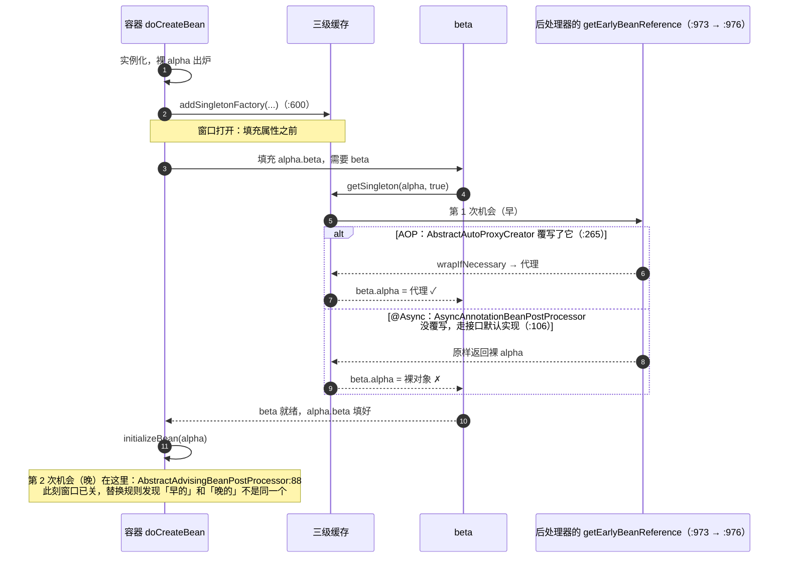

# 第 30 章：环环相扣，三级缓存与循环依赖

作者：Land-Fairy
<br/>仓库：[https://github.com/Land-Fairy/tiny-spring-tdd](https://github.com/Land-Fairy/tiny-spring-tdd)

> 沉淀、分享、成长，让自己和他人都能有所收获！😄

**本章代码**：`step-30-circular-dependencies`
**真实 Spring 对照基线**：`6.2.x`，本地参照仓 commit `daf955157871e4ac6f192e06b71d6cc595eb979b`
**本章只交付一件事**：把「检测到环」换成「解开环」，并且证明第二级缓存不够，第三级不是多一层保险，是必需的。

## 一、前言

`你这容器，凭啥一有环就炸？`

上个月帮一个团队看启动失败的单子。两个服务互相注入，`order` 要 `coupon`，`coupon` 要 `order`，本地跑得好好的，预发环境一启动就是一片红。产品在群里问，明天预售要不要推迟。运营那边物料已经印了 8 万份，就等着零点开抢。测试小姐姐把日志翻了三遍，只翻出一句「currently in creation」。

这类问题不新鲜，它比空指针难查。空指针给你一个行号，环给你一个形状，你得先看懂这个形状，才知道手艺往哪儿使。就编程开发来讲，容器里最反直觉的一件事就在这里，一个对象还没造完，你就得先把它交出去。交早了，交出去的是半成品。交晚了，两个对象谁也等不到谁。

被问到「Spring 怎么解决循环依赖」时，我听过三种回答，一种比一种接近，都不够用。

错误答案一，用三级缓存。这是把答案背下来了，没解释。三级各自解决什么问题，把中间那一级删掉会怎样，说不出来就等于没懂。

错误答案二，三级缓存是为了性能。反了。它是为了正确性，代价恰恰是性能，多两个 Map、多一次 `ObjectFactory` 间接调用、多一个「创建中」集合的读写。真实 Spring 里 `getSingleton` 的快路径之所以要写那么多遍判空，就是被这套机制逼出来的。

错误答案三，`@Lazy` 就能解环。那只解决了构造器注入的环里的一小类，把强依赖改成「用时再取」。setter 注入的环本来就能解，问题是解出来的对象对不对，`@Lazy` 一个字节都不帮忙。

而本章节说到三级缓存，就是因为我们需要把「环能解开」和「解出来的对象是对的」这两件事一次说清。*你要的不是不报错，是不出错。*

## 二、目标

上一章我们把 AOP 失效的六个场景钉成了 `AopPitfallTests` 里能跑的测试。其中两个场景留下了没还清的问题。

第一个，场景五，循环依赖在我们的容器里直接栈溢出，1024 帧 `doCreateBean`。第二个，场景六，就算环解开了，注入方拿到的也可能是裸对象，增强静默失效。

所以正确的答案不是一句口诀，是三个问题。

- 首先，什么时候允许别人拿到一个还没初始化完的对象。答案是实例化之后、填充属性之前，这是唯一的窗口。
- 那么，拿到的是哪个对象。交出裸对象，代理就丢了，必须让「要不要包代理」这个决定能推迟。
- 另外，一个环解开之后，池子里的对象和注入方手里的对象，是同一个吗。如果不是，就埋了第 29 章场景六那颗雷。

本章不打算只用断言回答这三问，用量具回答。同一份 XML、同一个容器，只把「提前暴露时交什么」换掉，看结果怎么变。四个实验，四盏红灯，每盏灯对应一个答错的版本。

**那么本章的目标就很明显了，来把这个洞填上！**

## 三、设计

### 1. 三个实验，一份 XML

实验材料只有一份 XML。

```xml
<bean id="alpha" class="org.springframework.samples.ch30.Alpha">
    <property name="beta" ref="beta"/>
</bean>
<bean id="beta" class="org.springframework.samples.ch30.Beta">
    <property name="alpha" ref="alpha"/>
</bean>
```

两个 Bean 都写成 setter 注入。这不是随便选的，构造器注入的环没有解，两个对象都得先有对方才能存在，那是逻辑矛盾，任何缓存都救不了。setter 注入的环才有解，先造空壳，等对方好了再填进去。

三个实验共用同一个容器实现，差别只在两个「能力开关」上。测试里用两个子类表达，不改产品代码。

| 实验 | 子类做了什么 | 等价于 |
| --- | --- | --- |
| 只有检测 | `addSingletonFactory` 空实现 | 「我知道有环，但我不提前暴露」 |
| 两级缓存 | `getEarlyBeanReference` 直接返回裸对象 | 「提前暴露，但交出的是算好的对象」 |
| 三级缓存 | 什么都不改 | 「提前暴露，交出的对象现算」 |

### 2. 红一：只有检测，环也炸

第一个实验把 `addSingletonFactory` 写成空实现，等于「我知道有环，但我不提前暴露」。

**实测输出**：

```
org.springframework.beans.factory.BeanCurrentlyInCreationException:
  Requested bean is currently in creation: Is there an unresolvable circular reference?
```

五个测试全红，包括普通环。这是本章第一个真实的教训，检测和解决是两件事。

第 29 章场景五是栈溢出，1024 帧 `doCreateBean`。现在是异常，错误信息从「栈的形状」变成了「图的形状」，好查多了。可这个环明明能解。*报错清楚和问题解决，是两码事。*

### 3. 红二：两级缓存丢了代理

加上提前暴露之后，普通环的测试绿了。代理场景的断言红了。

**实测输出**：

```
Expecting value to be true but was false
  ProxyCircularDependencyTests.threeLevelCacheKeepsTheProxy:89
```

你要看的断言是 `AopUtils.isAopProxy(beta.getAlpha())`。原因很清楚，提前暴露时我们交出去的是裸对象，而那时 `postProcessAfterInitialization` 还没跑，「要不要包代理」这个问题还没有答案。

### 4. 红三：第三级有了，回话的人不在

第三级缓存换成延迟工厂之后，仍然红。

因为工厂里问的是 `SmartInstantiationAwareBeanPostProcessor#getEarlyBeanReference`，而我们的自动代理创建器还没实现这个接口。默认实现返回原对象，于是工厂绕了一圈，还是交出裸对象。

补上 `getEarlyBeanReference` 之后才绿。这条红说明第三级缓存的关键不在「延迟」，在「延迟到谁来回话」。

### 5. 红四：两个 `toString` 一样的对象

最后一个红最值得看。两级缓存那次实验里，我加了一条「注入方与池子里是同一个对象」的断言。

**实测输出**：

```
Expecting actual:
  org.springframework.samples.ch30.Alpha@15a902e7
and:
  org.springframework.samples.ch30.Alpha@15a902e7
to refer to the same object
```

打印出来两个一模一样的 `Alpha@15a902e7`。`Object.toString` 用的是 identity hash，可它们不是同一个对象。

查下去才发现，池子里放的是 after 阶段正常包出来的代理，注入方手里是提前暴露的裸对象。代理把 `toString()` 转发给裸对象，于是两条字符串相同。

这正是第 29 章场景六的真实版本，也是真实 Spring 那条著名警告的现场。

**实测输出**：

```
Bean with name 'alpha' has been injected into other beans [beta] in its raw version as part of a
circular reference, but has eventually been wrapped. ...
```

真实 Spring 在这种情况下直接抛异常，`allowRawInjectionDespiteWrapping` 默认为 `false`。我们没抛，于是它成了一个可运行的反证测试。

### 6. 为了推迟一个决定，就要一个工厂

到这里，设计上的矛盾已经很硬了。为了把「交出去的时刻」和「能不能加工」拆开，就需要一个能延后求值的工厂。

生活里这道题你天天在办。你给卧室订了一张 1.8 米的床，师傅送到的时候地板还没铺完。你不能让他把床直接摆进去，也不能把床退回仓库。你只能先让他在玄关搁着，等地板铺完再搬进卧室。搁在玄关的是床本身，不是一张提货单。可要是这张床还得现场组装呢，玄关搁的就得是一张「随时能组装」的工序单。

三级缓存搁的就是这张工序单。

**图 30-1**　三个 Map 与一个窗口，谁在什么时候被调用（设计图待补）

那么这一章的分工就定下来了。

- 首先 `DefaultSingletonBeanRegistry` 管三个 Map 和「创建中」集合，它只回答「这个名字的成品、半成品、造法」在哪。
- 另外 `DefaultListableBeanFactory` 负责窗口和替换规则，因为只有它知道 `doCreateBean` 走到哪一步。
- 还有 `SmartInstantiationAwareBeanPostProcessor` 负责回话，要不要包代理这件事由它说了算，缓存不替它决定。

## 四、实现

### 1. 工程结构

新增主代码只有两个类，42 行的 `BeanCurrentlyInCreationException` 与 56 行的 `SmartInstantiationAwareBeanPostProcessor`。其余全是往三个已有类里加东西。

- `DefaultSingletonBeanRegistry`，433 行，三个 Map 与创建标记。
- `DefaultListableBeanFactory`，1170 行，窗口、替换规则、三级查找。
- `AbstractAutoProxyCreator`，204 行，提前把代理包出来。

```text
step-30-circular-dependencies/src/main/java/org/springframework/
├── beans/factory/BeanCurrentlyInCreationException.java
├── beans/factory/config/SmartInstantiationAwareBeanPostProcessor.java
├── beans/factory/support/DefaultListableBeanFactory.java
├── beans/factory/support/DefaultSingletonBeanRegistry.java
└── aop/framework/autoproxy/AbstractAutoProxyCreator.java
```

**工程源码**：GitHub 仓库 `Land-Fairy/tiny-spring-tdd`，本章代码在 `step-30-circular-dependencies/`

### 2. 建三级缓存

三个 Map 加一个集合，各管一件事。

**包：org.springframework.beans.factory.support**

```java
private final Map<String, Object> singletonObjects = new ConcurrentHashMap<>(256);          // 一级：成品
private final Map<String, Object> earlySingletonObjects = new ConcurrentHashMap<>(16);      // 二级：算好的提前引用
private final Map<String, ObjectFactory<?>> singletonFactories = new HashMap<>(16);         // 三级：算得出的办法
private final Set<String> singletonsCurrentlyInCreation = ConcurrentHashMap.newKeySet(16);  // 谁在创建中
```

一句话区分二、三级，二级存对象，三级存「怎么得到对象」。

- 二级缓存的语义是「现在」就把提前引用算出来给你。可 `alpha` 刚实例化完的那一刻，「该不该包代理」还没有答案，属性还没填、后处理器还没跑，只能交出裸对象。
- 三级缓存存的是一个工厂，等到真的有人来要才求值。那一刻我们已经在 `getEarlyBeanReference` 里问过了所有 `SmartInstantiationAwareBeanPostProcessor`，于是可以交出代理。

为什么还需要二级。因为工厂每调一次就会重新执行一遍。环里可能有两三个 Bean 都要 `alpha`，不把第一次的结果存下来，就会造出好几个代理，「同一个 Bean」这个前提就不成立了。

### 3. 划出唯一窗口

**包：org.springframework.beans.factory.support**

```java
private Object doCreateBean(String beanName, BeanDefinition beanDefinition) {
    Object bean = (... instantiate ...);
    // 实例化之后、填充属性之前——这是唯一能插入「提前暴露」的窗口。
    // 早了没有对象可暴露，晚了属性已经填完、环已经炸过。
    if (beanDefinition.isSingleton()) {
        addSingletonFactory(beanName, () -> getEarlyBeanReference(beanName, bean, beanDefinition));
    }
    populateBean(beanName, beanDefinition, bean);
    ...
}
```

「唯一窗口」的论证很硬，三条就把位置卡死了。

- 早于实例化，没有对象可交。
- 晚于 `populateBean`，属性里的环已经在填充期间炸过了，来不及。
- 而 `initializeBean` 必须排在填充之后，后处理器的 after 阶段就落在那里，所以「包代理」天然晚于「提前暴露」。

这三条合起来，就推出了第三级缓存的必要性。要交出去的时刻是填充期间，那时代理还不存在，而代理只可能在之后被造出来。于是唯一的出路是交出一个能延后求值的工厂。

### 4. 定一条替换规则

提前引用交出去之后，`initializeBean` 会正常跑完并返回一个对象。池子里该放哪个，得有个规矩。

**包：org.springframework.beans.factory.support**

```java
if (beanDefinition.isSingleton()) {
    Object earlySingletonReference = getSingleton(beanName, false);
    if (earlySingletonReference != null && initializedBean == bean) {
        initializedBean = earlySingletonReference;
    }
}
```

两个条件都成立才替换。

- `earlySingletonReference != null`，说明确实有人要过它。要没人要，二级缓存里就什么都没有，说明这个 Bean 根本没参与环，池子里放正常结果就行。
- `initializedBean == bean`，说明 after 阶段没有换过对象。换过，就说明正常路径已经包出了代理，而提前引用那一份是另一个对象，此时不该拿旧的覆盖新的。

第二条正是红四的成因。两级缓存实验里 `initializedBean != bean`，after 阶段包了代理，于是不替换，池子里放代理、注入方拿裸对象，一个 Bean 两个身份。

### 5. 报一句人话

栈溢出换成一句能读的异常，靠的是创建前登记、创建后摘牌。

**包：org.springframework.beans.factory.support**

```java
protected void beforeSingletonCreation(String beanName) {
    if (!this.singletonsCurrentlyInCreation.add(beanName)) {
        throw new BeanCurrentlyInCreationException(beanName);
    }
}

protected void afterSingletonCreation(String beanName) {
    this.singletonsCurrentlyInCreation.remove(beanName);
}
```

两个方法必须成对调用，并且 `afterSingletonCreation` 要放在 `finally` 里。创建失败时若不摘掉标记，这个 Bean 会永远「在创建中」，之后每一次合法创建都会被误判成环。

真正解不开的环，比如构造器注入的环，就会在这里抛出。能解的环根本走不到这一句，它们在 `getSingleton(beanName)` 的提前引用查找里就被满足了。

### 6. 定义回话的接口

**包：org.springframework.beans.factory.config**

```java
public interface SmartInstantiationAwareBeanPostProcessor extends BeanPostProcessor {

    default Object getEarlyBeanReference(Object bean, String beanName) {
        return bean;
    }
}
```

默认答案是「没什么可加工的」，原样奉还。自动代理创建器覆写它。

### 7. 覆写 getEarlyBeanReference

**包：org.springframework.aop.framework.autoproxy**

```java
@Override
public Object getEarlyBeanReference(Object bean, String beanName) {
    Object cacheKey = getCacheKey(bean.getClass(), beanName);
    this.earlyProxyReferences.put(cacheKey, bean);   // 记的是「原始对象」，只为判断包过没包过
    return wrapIfNecessary(bean, beanName);          // 现在就包成代理
}

@Override
public Object postProcessAfterInitialization(Object bean, String beanName) {
    if (this.earlyProxyReferences.remove(getCacheKey(bean.getClass(), beanName)) != bean) {
        return wrapIfNecessary(bean, beanName);
    }
    return bean;   // 已经包过了：这次返回裸对象，「池子里放哪个」交给 doCreateBean 决定
}
```

这里需要注意的是 `postProcessAfterInitialization` 在已经包过时返回的是裸对象。这看着像 bug，其实是分工，它只负责「别包两次」，「池子里放哪个」由前面那条替换规则负责。

### 8. 转发 getSingleton(String)

**包：org.springframework.beans.factory.support**

```java
@Override
public Object getSingleton(String beanName) {
    return getSingleton(beanName, true);
}
```

那个 `true` 是本章的枢纽。它意味着任何一次「按名字取单例」都允许拿到提前引用，而不只是「解析依赖」时。少了这个 `true`，环里的第二次 `getBean` 会一路走到 `getSingleton(name, factory)`，被「创建中」检测拦下，红一就是这么炸的。

那为什么还要留 `allowEarlyReference=false` 的调用。给「我只是想看一眼，别给我造东西」的查询用。`getBeanNamesForType`、`isTypeMatch` 这类探询如果拿提前引用，一次类型扫描就会把半成品对象提前造出来。

### 9. 拆开三级查找

**包：org.springframework.beans.factory.support**

```java
Object singletonObject = this.singletonObjects.get(beanName);                 // ① 成品
if (singletonObject == null && isSingletonCurrentlyInCreation(beanName)) {
    singletonObject = this.earlySingletonObjects.get(beanName);               // ② 算好的提前引用
    if (singletonObject == null && allowEarlyReference) {
        this.singletonLock.lock();
        try {
            singletonObject = this.singletonObjects.get(beanName);            // ③ 进锁后重读
            if (singletonObject == null) {
                singletonObject = this.earlySingletonObjects.get(beanName);
                if (singletonObject == null) {
                    ObjectFactory<?> singletonFactory = this.singletonFactories.get(beanName);
                    if (singletonFactory != null) {
                        singletonObject = singletonFactory.getObject();       // ④ 第一次求值
                        this.earlySingletonObjects.put(beanName, singletonObject);
                        this.singletonFactories.remove(beanName);
                    }
                }
            }
        }
        finally { this.singletonLock.unlock(); }
    }
}
```

三个细节值得记。

- `isSingletonCurrentlyInCreation` 是前置条件，不是性能优化。不在创建中却去查提前引用，等于允许「随便什么时候都能拿到半成品」，边界就没了。
- 进锁后要重读一遍，因为抢锁期间别的线程可能已经把它造完，第一级和第二级都可能变了。
- 求值后立刻搬进二级缓存并删掉工厂。工厂不能再被执行第二次，否则会造出第二个代理。

### 10. 清理三个 Map

`addSingleton` 里必须把二、三级都清掉。

**包：org.springframework.beans.factory.support**

```java
this.singletonObjects.putIfAbsent(beanName, singletonObject);
this.registeredSingletons.add(beanName);
this.earlySingletonObjects.remove(beanName);
this.singletonFactories.remove(beanName);
```

不清的后果很具体。下一次解析依赖时，`getSingleton(beanName, true)` 会先看二级缓存，拿到那个早就被替换掉的早期对象，又是第 29 章场景六。

### 11. 删掉一段死代码

**包：org.springframework.beans.factory.support**

`getBean(String)` 里原来有这么一段，第 06 章起就有，`registerSingleton` 直接注册现成对象的路径要用它。

```java
if (beanDefinition == null) {
    // 只有单例池里有：registerSingleton 直接注册的现成对象，没有图纸。
    return getObjectForBeanInstance(getSingleton(beanName), name, beanName, null);
}
```

本章在它上面加了「先问一句」的提前返回。

```java
Object sharedInstance = getSingleton(beanName);
if (sharedInstance != null) {
    return getObjectForBeanInstance(sharedInstance, name, beanName, beanDefinition);
}
```

加了这三行之后，那段旧分支就永远走不到了。它描述的情况，池里有、图纸没有，已经被上面的提前返回接住，于是走到它时 `getSingleton(beanName)` 一定是 `null`。真按那段代码执行，等于把 `null` 交给 `getObjectForBeanInstance`。

所以 `step-30` 到 `step-35` 把它删了，`step-06` 到 `step-29` 保留，因为那几章里它是活的。

这也是一课。加一条提前返回，会让别处的分支悄悄变成死代码。真实 Spring 里那段分支是活的，它的 `getBean` 没有这个提前返回。照抄上游的代码形状、再叠上自己的优化，很容易叠出一段既不生效、又能骗过所有人的代码。

判据很简单，删掉它，测试还是全绿，它就不是「为了将来」，是死代码。本章的 9,734 条测试就是判据。

### 12. 划一条能力边界

前面十一节都在讲三级缓存怎么把代理保住。这一节讲反面，有一种代理，三级缓存救不了它。

它也是真实项目里最容易踩的一脚。一个 `@Async` 方法撞上循环依赖，启动直接失败，报出来的却是一句 raw version 的警告。`spring-framework` 仓库里就挂着这样一份报告，issue [#35554](https://github.com/spring-projects/spring-framework/issues/35554)《Problem in `@Async` annotation and circular dependencies》，2025-09 提交，至今仍是 open 状态。

容器给后处理器留了两次「把裸对象包成代理」的机会。三级缓存只对第一次有效。

**时序：两次包装机会，一次在窗口里，一次在窗口外**



时序里有两个时刻，名字都很长，记住它们的先后就够了，`getEarlyBeanReference`（`:973`，早）与 `postProcessAfterInitialization`（`:88`，晚）。三级缓存能捎出去的，只有早那一刻求出来的对象。

### 13. 讲清一句根因

**根因一句话**

`@Async` 的代理是在初始化之后才创建的，走 `postProcessAfterInitialization`，而三级缓存能捎带出去的只有初始化之前求出的提前引用。早的那次它没覆写、给不出代理，晚的那次没人再回来取，于是环里的注入方永远拿不到异步代理。

对照组一句话。AOP 代理不炸，是因为 `AbstractAutoProxyCreator` 两个入口都实现了，提前引用那一次就把代理造出来（`:265`），after 阶段再从 `earlyProxyReferences` 里取回同一个对象。

`AsyncAnnotationBeanPostProcessor` 继承自 `AbstractAdvisingBeanPostProcessor`，`:37` 声明了 `SmartInstantiationAwareBeanPostProcessor`，但整个类没有覆写 `getEarlyBeanReference`，于是走接口默认实现 `SmartInstantiationAwareBeanPostProcessor:106`，`return bean;`，原样奉还。

### 14. 与第 27、28 章对照

同样是代理，命运不同。

**一个入口与两个入口**

| | AOP 代理（`AbstractAutoProxyCreator`） | `@Async` 代理（`AsyncAnnotationBeanPostProcessor`） |
| --- | --- | --- |
| 代理在哪个阶段产生 | `getEarlyBeanReference`（`:265`）与 `postProcessAfterInitialization`（`:315`）**两个**入口，先到先包、包过记账 | 只有 `postProcessAfterInitialization`（`AbstractAdvisingBeanPostProcessor:88`）**一个**入口 |
| 提前引用交出什么 | 代理（`wrapIfNecessary`），并记进 `earlyProxyReferences` | 裸对象（接口默认实现 `:106`） |
| 能不能进三级缓存 | 能 | 不能 |
| 环里有依赖方时的结果 | 注入方拿到代理，`isSameAs` 成立（第 30 章红二的绿灯） | 注入方拿到裸对象；真实 Spring 在 `:619`/`:622` 判定后于 `:631` 抛 `BeanCurrentlyInCreationException` |
| 没有环时 | 无差别 | 无差别（异步正常工作） |

两条交叉引用值得顺着读。

- 第 27 章回答「字段填在谁身上」。提前引用交出去的是代理，目标源在代理内部，这是本章三级缓存能成立的物理前提。`@Async` 恰好违反了这条前提。
- 第 28 章回答「`this` 不是代理」。`@Async` 上是它的变体，注入进来的那个也不是代理。两种情况下业务代码写的 `service.doAsync()` 都在同步执行，区别只是你在哪一层被骗。

### 15. 三种解法，以及什么时候不该用

**三种解题，一种藏题**

| 解法 | 怎么解开 | 代价 | 什么时候不该用 |
| --- | --- | --- | --- |
| `@Lazy` 注入 | 注入一个占位代理，真要用时才回容器取，环被时间错开 | 多一层代理；`final` 类、`final` 方法失效；类型判断变复杂 | 循环两端的调用都在构造期就要用到对方；或类被 `final` 修饰 |
| `ObjectProvider<T>` / `ObjectFactory<T>` | 同上，但把「延迟」写在代码里，意图更明确 | 每次取都是一次容器查询，写法变啰嗦；`getObject()` 的时机由你负责 | 只是偶尔用一次延迟、却要付全链路的可读性代价；或者团队里有人会把它当万能药 |
| 重构，拆掉环 | 抽出第三方法（C），A、B 都依赖 C；异步动作用事件/消息解耦 | 要改设计，短期成本最高 | 拆出来的是一个贫血的、只为消环而存在的类——那只是把环藏起来了 |
| （真实 Spring 的另一条路）`allowRawInjectionDespiteWrapping = true` | 允许裸版注入，容器不再抛异常 | **把错误静默化**：注入方拿到的是同步版，异步过期、事务失效，且没有任何日志 | 除了「先让启动过」的临时救火，正常代码里不该出现 |

最后一行是重点。前面三种是解题，最后一种是把题目藏起来。本章红四的容器行为恰好等于这一行，它不抛异常，于是不一致安静地留在那儿。

### 16. 把三种结局摊成一张表

**把两件事分开看**

二级缓存够不够的争论，得把两件事分开看。

能不能解开环，二级缓存单独就能解。红二证明了这个，普通环的测试是绿的，环确实解开了。

解出来的对不对，二级缓存解出来的对象，注入方拿到的是裸对象，而池子里放的是代理，红四。

于是答案取决于你准不准备接受「同一个 Bean 有两个身份」。真实 Spring 的选择是不接受，并且更进一步，检测到这种不一致就直接抛 `BeanCurrentlyInCreationException`（`:630`），而不是安静地留一个坑。

那为什么不用「延迟代理」，让二级缓存也存工厂。那就已经是三级缓存了。命名的区别不重要，机制的区别只有一条，交出去的时机与能不能加工，是不是解耦的。

`@Async` 给出了第三种组合，正好补全这张表。

| 配置 | 能不能解环 | 解出来对不对 |
| --- | --- | --- |
| 只有一/二级缓存 | 能（普通环） | **不对**：注入方是裸对象（红二） |
| 三级缓存 + AOP 代理 | 能 | **对**：注入方与池子里是同一个代理（红二的反面） |
| 三级缓存 + `@Async` 代理 | 能 | **不对**：注入方是裸的「同步版」；真实 Spring 直接抛异常 |

所以三级缓存不是代理保险箱。它只是把一个特定时机能算出来的代理保住，这个时机是初始化之前。后处理器在晚于那个时机才产生代理，缓存再好也只能看着。

**图 30-2**　本章最终的类关系（类关系图待补）

- 三个 Map 加一个集合落在 `DefaultSingletonBeanRegistry`，窗口和替换规则落在 `DefaultListableBeanFactory`。
- 回话的接口落在 `config`，包代理的实现落在 `autoproxy`，两个包各管一段。
- 边界也清楚了，只有早那一刻的代理能被回收，晚那一刻只能看着。

## 五、测试

### 1. 事先准备

测试类叫 `ProxyCircularDependencyTests`，四个红都在里面。配置是 `ch30/circular.xml`，就是那份两个 Bean 互相引用的 XML。跑法是 `./mvnw -pl step-30-circular-dependencies test`。

三个实验用两个子类表达，不改产品代码。四个红里前三个对应三档能力，红四是一条额外的断言，用来问「注入方和池子里是不是同一个对象」。

### 2. 单元测试

**最小复现：只实现 BeanPostProcessor 的后处理器**

这里补一组不用装 Spring 的复现实验。`@Async` 的行为可以用一个只实现 `BeanPostProcessor`、只在 after 阶段包装的后处理器等价模拟出来。它与 `AdvisorAutoProxyCreator` 的差别只有一行，谁被加进 `addBeanPostProcessor`。

```java
// @Async 的等价物：只在 after 阶段包装，不实现 SmartInstantiationAwareBeanPostProcessor
static class AsyncLikePostProcessor implements BeanPostProcessor {

	private final CountingInterceptor interceptor;

	AsyncLikePostProcessor(CountingInterceptor interceptor) {
		this.interceptor = interceptor;
	}

	@Override
	public Object postProcessAfterInitialization(Object bean, String beanName) {
		if (!"alpha".equals(beanName)) {
			return bean;
		}
		ProxyFactory proxyFactory = new ProxyFactory(bean);
		proxyFactory.addAdvice(this.interceptor);
		return proxyFactory.getProxy();
	}

}
```

跑两组，唯一差别是容器里挂哪个后处理器。

```java
CountingBeanFactory factory = new CountingBeanFactory();        // 数 getEarlyBeanReference 的调用
new XmlBeanDefinitionReader(factory).loadBeanDefinitions(new ClassPathResource("ch30/circular.xml"));
factory.addBeanPostProcessor(new AsyncLikePostProcessor(interceptor));   // 对照组换成 AdvisorAutoProxyCreator
factory.preInstantiateSingletons();
```

### 3. 测试结果

**测试结果**：测试 442 个，新增 4 个，行覆盖 86.6%（3050/3523），分支覆盖 76.0%（1176/1548）。

探针在 `/tmp/probe60`，跑在 `step-30-circular-dependencies/target/classes` 上。真实输出如下。

```text
── 对照组：AdvisorAutoProxyCreator（AOP 代理，走 getEarlyBeanReference）
   getEarlyBeanReference(alpha) 调用次数 = 1，交出去的提前引用是代理 = true
   池子里的 alpha 是代理 = true
   beta.getAlpha() 是代理 = true
   两者是同一个对象 = true
   通过注入引用调用 hello() = alpha，增强被调用次数 = 1

── 实验组：AsyncLikePostProcessor（@Async 那种 only-after 包装）
   getEarlyBeanReference(alpha) 调用次数 = 1，交出去的提前引用是代理 = false
   池子里的 alpha 是代理 = true
   beta.getAlpha() 是代理 = false
   两者是同一个对象 = false
   通过注入引用调用 hello() = alpha，增强被调用次数 = 0
```

这几行数字就是全部故事。同一份 XML、同一个环，只换掉一个后处理器，提前引用从代理变成裸对象，注入方手里的对象与池子里的对象从同一个变成两个，增强被调用次数从 1 变成 0。`beta` 背后那条路彻底绕过了异步。

真实 Spring 不会让这种不一致静默存在。它在 `:617` 拿到提前引用、在 `:619` 比较 `exposedObject == bean`，一旦发现「已经包过一层」就继续往下走，最后在 `:631` 抛异常。

本章没实现 `hasDependentBean` 与 `allowRawInjectionDespiteWrapping`，所以只能把那段判定抄成二十行，验证消息长什么样。

```text
── 真实 Spring 的判定（:617-637）在这组事实下的结果
   抛出：IllegalStateException
   消息含 "raw version" = true，含 "wrapped" = true
```

消息全文落在 `AbstractAutowireCapableBeanFactory:631-637`，「Bean with name 'alpha' has been injected into other beans [beta] in its raw version as part of a circular reference, but has eventually been wrapped. This means that said other beans do not use the final version of the bean.」这正是红四里引用过、而我们的容器还没有能力抛出的那句话。

## 六、总结

- 本章做了什么。写进 `DefaultSingletonBeanRegistry` 的是三个 Map 与创建标记，写进 `DefaultListableBeanFactory` 的是窗口与替换规则，新加的是 `BeanCurrentlyInCreationException` 与 `SmartInstantiationAwareBeanPostProcessor`，`AbstractAutoProxyCreator` 学会了在提前引用那一刻就把代理包出来。
- 这条技术线背后的设计道理。缓存不是安全垫，每一层都在回答一个当时答不出来的问题。
- 给你的动作。把本章那段替换规则删掉，跑一遍测试，看红四怎么回来。*看只能是知道，动手才能学会！*

第一，先分清能不能与对不对。二级缓存能解环，能不能这一问答案是能，可解出来的对象有两个身份，对不对这一问答案是不对。很多技术争论的双方，其实在回答不同的问题。

第二，延迟的价值在于把决定推给更有信息的时刻。第三级缓存不是多存一份，而是把「要不要包代理」这个问题推迟到真有人要的那一刻，那时后处理器已经能回答了。

第三，成对的生命周期方法必须放在 `finally` 里。`beforeSingletonCreation` 与 `afterSingletonCreation` 一旦漏摘标记，一个创建失败的 Bean 会永久「在创建中」，之后所有合法创建都会被误判成环。这类 bug 只在异常路径上出现，平时真测不到。

### 1. 对回真实 Spring：我们砍掉了什么

先看行号。下面这张表把本章涉及的每一处坐标都对上了真实 Spring 6.2.x 的源码。

| 我们的实现 | 真实 Spring（6.2.x） | 行数 |
| --- | --- | --- |
| `singletonObjects` | `DefaultSingletonBeanRegistry.java:85` | `ConcurrentHashMap<>(256)` |
| `singletonFactories` | `:88` | 6.2 起是 `ConcurrentHashMap`（我们用 `HashMap` + 锁） |
| `earlySingletonObjects` | `:94` | `ConcurrentHashMap<>(16)` |
| `registeredSingletons` | `:97` | `Collections.synchronizedSet(new LinkedHashSet<>(256))` |
| `singletonsCurrentlyInCreation` | `:100` | `ConcurrentHashMap.newKeySet(16)` |
| `addSingleton` | `:159` | 清二、三级 |
| `addSingletonFactory` | `:183` | 存工厂 |
| `getSingleton(String)` | `:197` | `return getSingleton(beanName, true);` |
| `getSingleton(String, boolean)` | `:210` | 三级查找 |
| `beforeSingletonCreation` / `afterSingletonCreation` | `:542` / `:554` | 成对调用 |
| `BeanCurrentlyInCreationException` | `BeanCurrentlyInCreationException.java`（48 行） | 消息句式与我们一致 |
| `addSingletonFactory(...)` 调用点 | `AbstractAutowireCapableBeanFactory.java:600` | 实例化后、`populateBean` 前 |
| 提前引用替换 | `AbstractAutowireCapableBeanFactory.java:618-647` | 我们只保留核心两个条件 |
| 「裸版注入」异常 | `AbstractAutowireCapableBeanFactory.java:630-641` | 消息在 `:634` |
| `getEarlyBeanReference`（容器侧） | `AbstractAutowireCapableBeanFactory.java:973`（循环 `:977`） | 遍历 `SmartInstantiationAwareBeanPostProcessor` |
| `SmartInstantiationAwareBeanPostProcessor#getEarlyBeanReference` | `SmartInstantiationAwareBeanPostProcessor.java:106`（出处 `spring-beans` 6.2.x） | 默认返回原对象 |
| `getEarlyBeanReference`（代理侧） | `AbstractAutoProxyCreator.java:265`（出处 `spring-aop` 6.2.x） | 先记原始对象，再包 |
| `postProcessAfterInitialization` | `AbstractAutoProxyCreator.java:315`（出处 `spring-aop` 6.2.x） | 包过就返回裸对象 |
| `getCacheKey` | `AbstractAutoProxyCreator.java:337`（出处 `spring-aop` 6.2.x） | `FactoryBean` 会加 `&` 前缀 |
| `wrapIfNecessary` | `AbstractAutoProxyCreator.java:354`（出处 `spring-aop` 6.2.x） | 真正的包装 |

**深水区：那个 tryLock，我们做错的地方**

真实 `getSingleton(beanName, allowEarlyReference)` 抢锁用的是 `tryLock()`，抢不到直接返回 `null`。

```java
if (!this.singletonLock.tryLock()) {
    // Avoid early singleton inference outside of original creation thread.
    return null;
}
```

注释把这件事故意说破了，提前引用只应该在「正在创建这个 Bean 的那个线程」里被推导出来。

换成 `lock()` 会怎样。另一个线程来要提前引用时会阻塞在锁上，一直等到创建线程把整条创建链走完。这不是死锁，是串行，第 31 章 `31-concurrency.md:104` 有正式更正，全类只有一把可重入锁，等待图成不了环。代价是等待时间被拉长到整条链的长度。

而我们用的是 `lock()`。这是本章如实记录的缺陷，单线程测试永远发现不了，只有在并发创建撞上循环依赖时才会卡住。

**深水区：与 @Lazy 的分工**

`@Lazy` 注入的是代理，一个 `ObjectFactory` 的前身，所以它能让构造器注入的环变成可解。先把一个还没初始化的代理塞进去，等真要用时再从容器取。

但它与三级缓存解决的不是同一个问题。

| | 三级缓存 | `@Lazy` |
| --- | --- | --- |
| 解决 | setter/字段注入的环，且**保证代理不丢** | 构造器注入的环（提前给占位代理） |
| 代价 | 两个 Map、一次工厂调用、`isCurrentlyInCreation` 读写 | 多一层代理、类型判断变复杂、`final` 类不可用 |
| 边界 | 只对单例有效 | 对 prototype 也有效 |

**深水区：这一章砍掉了什么**

| 省略的东西 | 真实 Spring 怎么做 | 影响 |
| --- | --- | --- |
| `tryLock` 与「非创建线程不推导提前引用」 | `:213-217` | 我们只是**串行**（第 31 章更正：单锁不可能死锁），但等待时间 = 整条创建链 |
| 「裸版注入」检测 | `:630-641` 抛 `BeanCurrentlyInCreationException` | 我们让不一致静默存在（红四） |
| `hasDependentBean` / `dependentBeanMap` | `:626` 起依赖登记 | 我们无法判断「谁被注入了裸版」 |
| `getSingletonMutex()` 对子类暴露 | `SingletonBeanRegistry` | 我们没有 `refresh` 期的一致性协议 |
| `FactoryBean` 的 `&` 前缀缓存键 | `AbstractAutoProxyCreator:337` | 我们的 `FactoryBean` 与产品共用键 |
| 作用域 `prototype` 的环处理 | 无（prototype 不提前暴露） | 我们的 prototype 环会栈溢出 |
| `ObjectProvider` / `@Lazy` 占位代理 | `ContextAnnotationAutowireCandidateResolver` | 只在本章 5.4 对比，不实现 |
| `@Async` 这类「只在 after 阶段包装」的后处理器 | `AbstractAdvisingBeanPostProcessor:88` 无 `getEarlyBeanReference` 覆写 | 第 [6 节](#6-能力边界async-为什么让三级缓存失效) 用自造后处理器做了对照实验 |

### 2. 五个问题留给你

先自己写，再看 [`../../appendix/B-answers.md#第-30-章`](../../appendix/B-answers.md#第-30-章)。

1. 为什么「提前暴露」的窗口只能在「实例化之后、填充属性之前」？请给出上界和下界各自的论证，并说明为什么这个窗口恰好推出「必须用工厂而不是对象」。
2. 我们的 `getSingleton(beanName, true)` 在拿不到锁时用 `lock()` 等待，真实 Spring 用 `tryLock()` 并返回 `null`。请说明这两种做法在「并发创建 + 环」下分别发生什么，为什么我们的版本不会死锁、只是串行？串行又会让哪个线程多等多久？第 31 章与附录 B-30-2 有正式更正。
3. 红四里两个 `Alpha@15a902e7` 为什么打印一样却不是同一个对象？如果这个 Bean 的 `hashCode`/`equals` 被业务重写过，这条 bug 会以什么形式暴露？
4. `addSingleton` 里如果忘了清 `earlySingletonObjects`，会出现什么现象？请写出一个能复现的测试步骤，提示是让容器在同一个名字上创建两次。
5. 三级缓存让「同一个 Bean 的早期形态与最终形态是同一个对象」成立。但 `prototype` 作用域完全没有这套机制，为什么？这个差别是否意味着 prototype 的循环依赖无解？

### 3. 下一章

下一章把这三层缓存放回容器的整体生命周期里看，`refresh()` 的十二步、BeanFactory 后处理器与 Bean 后处理器的分工、以及为什么「容器自己也要能被扩展」。前面十章散落的钩子，会在那里连成一条线。

*缓存的层级不是「越多越安全」，而是「每加一层，回答一个当时答不出来的问题」。*
